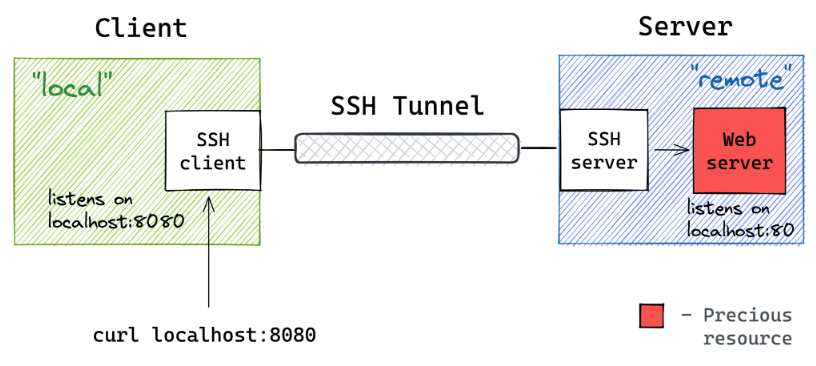

> **Bandit Series** — **Level 0** of 33 &nbsp;|&nbsp; [Series Intro](/posts/bandit-otw-intro/) &nbsp;»&nbsp; [Level 1 →](/posts/bandit-otw1/)
{: .prompt-tip }

# Introduction

In this first level of Bandit, we’re getting started by learning how to connect to a remote machine using SSH. This level sets the foundation for the rest of the game and is perfect for anyone just starting out with Linux or cybersecurity.

# Task 

The goal of this level is to connect to the Bandit game using SSH on port 2220 and retrieve the password for Level 1 from a file named readme.

Port: 2220 
Username: bandit0 
Password: Bandit0


# Theory 

## SSH (Secure Shell)

SSH is a secure way to remotely log into another machine over the internet or a local network. It encrypts the connection, so anything you send (like passwords or commands) is protected.



when we are working with Linux we often want to connect to a remote machine we can use SSH, If you want to know more information about any Linux command we simply use the ```man``` command, this will open the man page for the command you want to use. For Example if we want to see how to use ```ssh``` we can type the command ```man ssh```. 

if you are using windows you can use the [PuTTY](https://www.putty.org/) utility or simply using the terminal.

To ssh into the machine, I use will use Linux. the basic command structure of the ssh we need to use for this level. 

```ssh <username>@<hostname/ip> -p <port>```
the parts with <,> you should replace it with the real values. 
```<username>``` should be replaced with the username of the user you will login by in the system. 
```<hostname/ip``` you should replace it with either the hostname or the ip of the server you want to login in, if we leave the command without using `-p` it will connect to the default port which is 22 but as you can see the ssh is open at port 2220 so we need to tell the `ssh` utility to change the ip that it will connect on.

now after we login to the level we want to read the content of the file called `readme` so how to know where is the file ?

we can now introduce you to the command of the linux :
- `ls` Lists the files/dirs in you current working directory(folder) , if you typed it without passing anything it will list the current directory or you can specify a dir to list for example : `ls /etc` will list all the contents of the `etc` directory. `ls` can take some other options called flags which can be used to request more output specification like `-a` which lists all files and dir even the hidden ones !, `-l` will list also the files/dir but this will output more details about each file.
- `cat` this command will output the content of any file in the terminal just by putting the file name to it. `cat /etc/passwd`. 
- `pwd` this command tells you in which directory you are in, the `~` symbol means the home dir of the current user. 

# Solution

1. Logging in the machine using ssh, `ssh bandit0@bandit.labs.overthewire.org -p 2220` you will be in the home dir of the user bandit0 you can check this by using the command `pwd` or the `~` symbol in the terminal. 
2. Now we want to see if the `readme` file is in the dir we are in or not stimply we will just type `ls` and we should get and output like this :  

